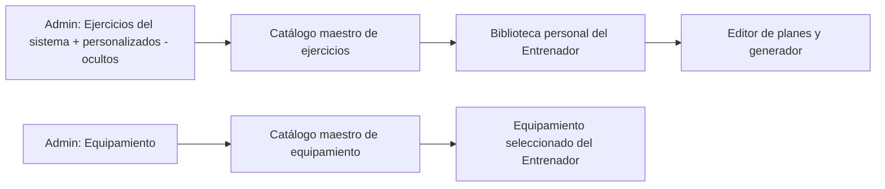

# Rol Administrador — Documentación Funcional Completa

Este documento describe en detalle todo lo que puede hacer el **Administrador (ADMIN)** dentro de Expert Sports Planner, cómo funciona cada sección del panel y qué reglas aplican. Para las credenciales y la inicialización del super usuario ver [ADMIN.md](./ADMIN.md). Para los otros roles ver [ROL_ENTRENADOR.md](./ROL_ENTRENADOR.md) y [ROL_ATLETA.md](./ROL_ATLETA.md).

## Índice

1. [Visión general del rol](#1-visión-general-del-rol)
2. [Acceso y sesión](#2-acceso-y-sesión)
3. [Estructura y navegación del panel](#3-estructura-y-navegación-del-panel)
4. [Panel General (Overview)](#4-panel-general-overview)
5. [Gestión de Usuarios](#5-gestión-de-usuarios)
6. [Base de Datos de Ejercicios](#6-base-de-datos-de-ejercicios)
7. [Gestión de Equipamiento](#7-gestión-de-equipamiento)
8. [Análisis y Estadísticas](#8-análisis-y-estadísticas)
9. [Configuración del Sistema](#9-configuración-del-sistema)
10. [Modo "Ver como" (vista previa de perfiles demo)](#10-modo-ver-como-vista-previa-de-perfiles-demo)
11. [Relación del Admin con los catálogos de Entrenadores](#11-relación-del-admin-con-los-catálogos-de-entrenadores)
12. [Persistencia de datos](#12-persistencia-de-datos)
13. [Reglas y restricciones](#13-reglas-y-restricciones)
14. [Limitaciones actuales](#14-limitaciones-actuales)

---

## 1. Visión general del rol

El Administrador es el **único rol que no participa del día a día de entrenamiento**. No crea planes ni reserva turnos. Su función es:

- Supervisar el estado global de la plataforma (usuarios, planes, reservas, equipamiento).
- Administrar a los **usuarios** registrados.
- Mantener los **catálogos maestros** de ejercicios y de equipamiento, de los cuales cada entrenador luego elige para armar su biblioteca personal.
- **Inspeccionar** la app tal como la ven un entrenador y un atleta, mediante perfiles de demostración.

Características del super administrador:

| Propiedad           | Valor                                                   |
| ------------------- | ------------------------------------------------------- |
| Rol                 | `ADMIN`                                                 |
| Plan de suscripción | `GYM` (estado `ACTIVE`)                                 |
| Límites             | Sin límites (atletas, planes y entrenadores = infinito) |
| Trial               | No aplica (`trialEndsAt` nulo)                          |
| Identificador fijo  | `admin-super-user`                                      |
| Marca especial      | `isSuper: true` (no se puede eliminar)                  |

---

## 2. Acceso y sesión

### Creación automática

El super administrador se crea o actualiza automáticamente al iniciar la app (`initializeSuperAdmin`). Sus credenciales salen de variables de entorno (`VITE_ADMIN_EMAIL`, `VITE_ADMIN_PASSWORD_HASH`, `VITE_ADMIN_NAME`) definidas en `.env.local`, que no se versiona.

- Si las variables no están configuradas, la inicialización falla con el error _"Credenciales de administrador no configuradas"_.
- Si el admin ya existe y cambiaron email, nombre o el hash de `.env` (`VITE_ADMIN_PASSWORD_HASH`), se **actualiza** el registro existente. Para no revertir una contraseña cambiada desde el panel, el registro guarda `envPasswordHash` (último hash de `.env` aplicado) y solo pisa la contraseña cuando ese valor cambia.
- Si no existe, se crea con el plan `GYM` y límites infinitos.

### Inicio de sesión

- Desde la pantalla de autenticación (`AuthPage`) con email y contraseña. Las contraseñas se guardan con **PBKDF2-SHA256 y sal aleatoria** (`pbkdf2$iteraciones$sal$hash`). Los hashes antiguos SHA-256 (incluido el de `.env`) siguen siendo válidos y se migran automáticamente al iniciar sesión.
- En desarrollo existe el botón **"Acceso temporal como Super Admin (dev)"** (`quickAdminLogin`). Solo se renderiza con `import.meta.env.DEV` y la acción además exige `localhost`/`127.0.0.1`.
- Las acciones administrativas (`adminChangePlan`, `adminExtendTrial`, `adminDeleteUser`, `adminChangeOwnPassword`) validan que el actor exista, sea ADMIN y, si hay sesión activa, que la sesión sea la del mismo actor.
- El rol ADMIN **no se puede elegir al registrarse**: el registro público solo ofrece Entrenador y Atleta.

### Cierre de sesión

- Botón **"Cerrar Sesión"** en el encabezado del panel.
- Si el admin está en modo "Ver como" (vista previa), el botón de salida termina primero la vista previa y lo devuelve al panel (ver [sección 10](#10-modo-ver-como-vista-previa-de-perfiles-demo)).

---

## 3. Estructura y navegación del panel

El panel (`AdminDashboard`) se compone de un **sidebar de navegación** y un **área de contenido** con encabezado.

### Encabezado

- Ícono de escudo + **título dinámico** según la sección activa.
- Subtítulo: _"Bienvenido, {nombre} • Sistema de Gestión Integral"_.
- Botón **Cerrar Sesión**.

### Secciones del sidebar

| Sección       | Título que muestra          | Descripción                                                            |
| ------------- | --------------------------- | ---------------------------------------------------------------------- |
| Panel General | Panel General               | Métricas globales y acceso al modo demo                                |
| Usuarios      | Gestión de Usuarios         | Listado, filtros, acciones en lote, detalle, plan, trial y eliminación |
| Ejercicios    | Base de Datos de Ejercicios | Catálogo maestro (8 categorías) y completitud de datos                 |
| Equipamiento  | Gestión de Equipamiento     | Catálogo maestro de equipamiento                                       |
| Análisis      | Análisis y Estadísticas     | Gráficos, cohorte de conversión y registros por mes                    |
| Configuración | Configuración del Sistema   | Trial, respaldo, seguridad, datos operativos, bitácora y tema          |

### Comportamiento del sidebar (responsive)

- **Escritorio (≥ 1200 px):** el sidebar es fijo, ocupa 280 px a la izquierda y el contenido deja ese margen.
- **Tablet y móvil (< 1200 px):** el sidebar se oculta fuera de pantalla. Un **botón de hamburguesa** fijo arriba a la izquierda lo abre.
  - Al abrirse, el botón se **transforma en una X** (animación de las tres barras) y se ubica en la esquina derecha del encabezado del sidebar, en el lugar del cierre.
  - Se muestra un **overlay oscuro** detrás; tocarlo cierra el sidebar.
  - Al seleccionar una sección, el sidebar se cierra automáticamente.
  - El ancho del sidebar se adapta: hasta 320 px en tablet (92 % del ancho), 95 % en móviles pequeños y 96 % en pantallas muy pequeñas.
  - El contenido reserva espacio superior para que el botón no tape el título.
- Pie del sidebar: tarjeta del usuario (avatar "A", _Administrador_, _Super Admin_).

### Transiciones

Al cambiar de sección el contenido se anima con un fundido suave y un pequeño desplazamiento vertical (≈ 0,18 s).

---

## 4. Panel General (Overview)

Es la pantalla inicial. Reúne tres bloques.

### 4.1 Panel Demo (colapsable)

Tarjeta que se puede plegar/desplegar (chevron). Contiene:

- Texto explicativo: permite ingresar como un perfil de demostración para ver el alcance de la app.
- Botones **"Ver como Entrenador"**, **"Ver como Atleta 1"** y **"Ver como Atleta 2"** (ver [sección 10](#10-modo-ver-como-vista-previa-de-perfiles-demo)).
- Debajo de cada botón de atleta, un contador de datos de prueba: _"N planes • N gym • N citas"_. Sirve para verificar de un vistazo que los datos mock existen, sin entrar al modo "Ver como". Solo cuenta reservas y citas no canceladas.
- Botón **"Ver ícono de carga"**: abre un modal con el indicador de carga de pulso (`PulseLoader`) para revisarlo visualmente.

### 4.2 Tarjetas de métricas (6)

| Tarjeta                 | Valor principal                            | Detalle inferior                     |
| ----------------------- | ------------------------------------------ | ------------------------------------ |
| Usuarios Totales        | Total de usuarios registrados              | Entrenadores • Atletas               |
| Planes de Entrenamiento | Planes activos + completados               | Activos • Completados                |
| Trials Activos          | Usuarios con suscripción en estado `TRIAL` | "Plan FREE de N días" (configurable) |
| Equipamiento Registrado | Total de ítems del catálogo                | Disponible • Mantenimiento           |
| Ejercicios en BD        | Total de ejercicios del sistema            | Cantidad de categorías               |
| Reservas y Citas        | Reservas de gimnasio + citas               | Gimnasio • Citas                     |

> El cálculo proviene de `useAdminStats` (usuarios, planes, equipamiento) y de datos adicionales del dashboard (trials, reservas y citas).

### 4.3 Seguimiento y alertas (`OverviewInsights`)

- **Registros del mes:** altas de entrenadores y atletas desde el día 1.
- **Trials por vencer (7 días):** lista con botón **+7 d** para extender.
- **Trials vencidos:** usuarios en estado `EXPIRED` con botón **Reactivar +7 d** (deja el trial activo).
- **Alertas de equipo:** en mantenimiento, fuera de servicio y mantenimiento vencido, con acceso directo a Equipamiento.
- **Salud de datos:** usuarios sin email, equipos sin mantenimiento registrado y ejercicios sin imagen, con acceso directo a Ejercicios.
- **Actividad reciente:** las 6 últimas acciones de la bitácora.

**Gestión de cuenta (detalle de usuario):** editar nombre y email (valida formato y duplicados), suspender o reactivar (bloquea el login y cierra la sesión abierta) y generar una clave temporal que se muestra una sola vez. No aplica a administradores ni a la propia cuenta.

**Cierre por inactividad:** Configuración permite fijar minutos (por defecto 30; 0 desactiva); avisa 1 minuto antes. El Panel General muestra la antigüedad del último respaldo y sugiere hacerlo si supera 14 días. Cada vista tiene un límite de errores y se carga bajo demanda.

**Búsqueda global:** botón de lupa en la cabecera o `Ctrl+K`; busca sin distinguir tildes en usuarios, ejercicios y equipamiento y navega a la vista del resultado.

**Equipamiento:** botones Exportar e Importar (JSON, máx. 2 MB; omite duplicados e inválidos y muestra resumen). Un admin no puede cambiar su propio plan.

### 4.4 Resumen de tipos

Dos tarjetas de referencia:

- **Tipos de Sesión:** código y nombre (por ejemplo `DRO` Desarrollo, `REC` Recuperación).
- **Tipos de Entrenamiento:** los primeros seis códigos con su nombre (por ejemplo `SER` Series, `FTK` Fartlek).

---

## 5. Gestión de Usuarios

Permite ver y depurar todas las cuentas de la plataforma.

### 5.1 Listado

Tabla con las columnas: **selección** (casilla), **Nombre** (con avatar; escudo para el super admin), **Email**, **Rol**, **Plan**, **Estado** (con aviso "N d" si el trial vence en 7 días o menos), **Registro** y **Acciones**.

- **Rol:** insignia `ADMIN`, `TRAINER` o `ATHLETE`.
- **Plan:** `FREE`, `BASIC`, `PRO` o `GYM` (por defecto muestra `FREE` si no hay dato).
- **Estado:** `ACTIVE`, `TRIAL`, `EXPIRED` o `CANCELLED` con color propio.
- **Registro:** fecha de creación en formato local.
- **Orden** por nombre, plan o fecha (clic en el encabezado) y **paginación** de 10 filas.

### 5.2 Búsqueda y filtros

Campo **"Buscar usuarios..."** (nombre o email, sin distinguir mayúsculas) y filtros por **rol** y **plan**. Si no hay coincidencias: _"No se encontraron usuarios"_.

### 5.3 Resumen inferior

Contadores: **Total Usuarios**, **Entrenadores**, **Atletas** y **Administradores** (sobre el total, sin aplicar filtros).

### 5.4 Ver detalles y acciones individuales

Botón con ícono de ojo. Abre el modal **"Detalles del usuario"** con avatar, nombre, email, rol, fecha de registro, plan, estado y fin del trial. Para entrenadores y atletas permite **cambiar el plan** y **extender el trial** (+7/+14/+30 días, reactiva los `EXPIRED`).

### 5.5 Acciones en lote y exportación

- Las casillas seleccionan usuarios (nunca administradores, super admin ni el propio actor); la casilla del encabezado selecciona la página.
- Con selección aparece una barra con **Aplicar plan**, **Extender trial** y **Limpiar**. Cada acción se ejecuta por usuario, informa éxitos/errores y deja una entrada en la bitácora.
- **Exportar CSV:** descarga la selección o, si no hay, la lista filtrada (con BOM UTF-8 y protección contra inyección de fórmulas).
- **Nuevo usuario:** crea una cuenta con clave temporal (botón Copiar); la clave temporal de "restablecer" también se puede copiar. No se obliga a cambiarla en el primer ingreso.
- **Equipamiento y ejercicios:** además del JSON, botón CSV; la importación muestra una vista previa (cuántos se agregan/omiten) antes de aplicar, y eliminar ofrece Deshacer durante unos segundos. Las búsquedas usan retardo (debounce).

### 5.6 Eliminar usuario

1. Botón de papelera (no se muestra para el super admin ni para uno mismo).
2. Diálogo de confirmación que detalla los datos asociados que se borrarán.
3. Al confirmar se elimina la cuenta y, en cascada (`purgeUserData`), sus planes, solicitudes, reservas de gimnasio (liberando cupos), citas y mediciones.

**Reglas:** el super administrador no puede eliminarse (doble protección) y La cascada es atómica por usuario: si falla la limpieza, se restauran los datos y la cuenta (`adminRestoreUser`).

### 5.7 Qué NO se puede hacer desde esta pantalla

Crear usuarios ni cambiar roles.

---

## 6. Base de Datos de Ejercicios

Es el **catálogo maestro** de ejercicios. Lo que el admin define aquí es el universo disponible para que cada entrenador elija en su biblioteca personal.

### 6.1 Organización

Los ejercicios del sistema se agrupan en **8 categorías**: `LOWER` (tren inferior), `UPPER_PUSH` (empuje), `UPPER_PULL` (tracción), `CORE`, `FULL_BODY` (cuerpo completo: olímpicos y potencia), `PLIOMETRICO`, `CARDIO` y `MOVILIDAD` (movilidad y estiramientos). Cada categoría se muestra como una tarjeta con su nombre y contador. El catálogo incluye **1022 ejercicios** del sistema; el encabezado muestra el total (_"N ejercicios en total"_).

**Origen de los datos:** los ejercicios nuevos y sus metadatos provienen de [free-exercise-db](https://github.com/yuhonas/free-exercise-db) (dominio público), con nombres e instrucciones traducidos al español por IA (conviene revisarlos). Las imágenes se cargan desde GitHub (`raw.githubusercontent.com`) y son fotos estáticas. Músculos, equipamiento y partes del cuerpo están en español.

| Archivo                             | Contenido                                                                                                |
| ----------------------------------- | -------------------------------------------------------------------------------------------------------- |
| `src/utils/constants.ts`            | Catálogo base (`GYM_EXERCISES`), etiquetas de categoría y metadatos curados a mano (`EXERCISE_METADATA`) |
| `src/utils/exerciseCatalogNames.ts` | Ejercicios importados por categoría (generado)                                                           |
| `src/utils/exerciseCatalogData.ts`  | Metadatos del catálogo completo (generado; se carga aparte del bundle principal)                         |

Prioridad de metadatos: personalizados del admin (`crm_custom_exercise_meta`) > curados (`EXERCISE_METADATA`) > catálogo importado. Los ejercicios importados se añaden siempre al final de cada categoría (el generador de planes usa los primeros de cada lista). Unos 161 ejercicios originales no tenían equivalente en la fuente: tienen músculos, equipo e instrucciones generados por IA, pero **sin imagen**.

### 6.2 Búsqueda y filtros

- **Buscar ejercicio por nombre:** filtra en vivo en todas las categorías, sin distinguir mayúsculas ni acentos; incluye botón para limpiar. Si no hay resultados: _No se encontraron ejercicios para "{texto}"_.
- **Filtro de categoría:** desplegable _"Todas las categorías"_ o una categoría concreta con su contador.
- **Filtro de datos faltantes:** _Sin imagen_, _Sin instrucciones_ o _Sin músculos_ (con contadores) para completar el catálogo desde el admin.
- **Mover en lote:** con un filtro o búsqueda activos aparece _"Mover filtrados a..."_; reubica todos los ejercicios mostrados en otra categoría (con confirmación y registro en la bitácora).
- **Equipamiento:** casillas de selección con barra de acciones en lote (estado y fecha de mantenimiento) e historial de mantenimientos (hasta 20 fechas) por equipo.
- **Estadísticas:** muestra altas del mes actual vs el anterior con variación porcentual.

### 6.3 Agregar ejercicio

Botón **"Agregar Ejercicio"** abre un modal con:

- **Nombre** del ejercicio.
- **Categoría** (por defecto tren inferior).
- **URL del GIF** (opcional).
- **Partes del cuerpo**, **músculos objetivo**, **músculos secundarios** y **equipamiento** (listas separadas por coma).
- **Instrucciones** (un paso por línea).

Los campos de metadata son opcionales; solo se guardan los que se completen. Toast de éxito: _"Ejercicio agregado correctamente"_.

### 6.4 Ver detalle

Si un ejercicio tiene metadata (propia o del sistema), aparece un chevron que despliega:

- Etiquetas de partes del cuerpo, músculos objetivo (destacados), secundarios y equipamiento.
- Lista numerada de instrucciones.
- En la fila del ejercicio se muestra una **miniatura** del GIF si existe; si no, un ícono genérico.

### 6.5 Editar ejercicio

Ícono de lápiz en cada fila. Abre el mismo modal precargado con la metadata actual. Toast: _"Ejercicio actualizado correctamente"_.

Comportamiento interno importante:

- Si se edita un ejercicio **del sistema**, el original se **oculta** y se crea una versión **personalizada** con los cambios (el catálogo base nunca se modifica).
- Si se edita uno **personalizado**, se reemplaza directamente (incluyendo cambio de nombre o categoría).
- La metadata se guarda asociada al **nombre** del ejercicio; si cambia el nombre, la metadata se traslada.

### 6.6 Eliminar ejercicio

Ícono de papelera, con confirmación _"¿Estás seguro de eliminar "{nombre}"?"_. Toast: _"Ejercicio eliminado"_.

- Ejercicio **del sistema:** no se borra realmente, se **oculta** (lista de ocultos por categoría).
- Ejercicio **personalizado:** se elimina de verdad, junto con su metadata.

### 6.7 Identificación visual

Los ejercicios creados por el admin muestran una insignia **"Personalizado"**.

### 6.8 Persistencia

Claves de `localStorage`: `crm_custom_exercises`, `crm_hidden_exercises`, `crm_custom_exercise_meta`.

---

## 7. Gestión de Equipamiento

Catálogo maestro del equipamiento de gimnasio. Los entrenadores eligen de aquí qué tienen disponible en su gimnasio.

### 7.1 Vista

Cuadrícula de tarjetas. Cada tarjeta muestra:

- Ícono de paquete e indicador de estado (check para _Disponible_, alerta para otros).
- **Nombre** del equipo.
- **Categoría** (etiqueta) y **Cantidad**.
- **Fecha del último mantenimiento**.
- Acciones: editar (lápiz) y eliminar (papelera).

### 7.2 Búsqueda

Campo **"Buscar equipamiento..."**: filtra por nombre o categoría. Si no hay resultados se muestra estado vacío con el botón **"Agregar Primer Equipo"**.

### 7.3 Agregar / editar equipo

Modal con los campos:

| Campo                | Detalle                                                            |
| -------------------- | ------------------------------------------------------------------ |
| Nombre del Equipo    | Obligatorio                                                        |
| Categoría            | Obligatoria: Pesas Libres, Máquinas, Cardio, Funcional, Accesorios |
| Estado               | Disponible, Mantenimiento o Fuera de servicio                      |
| Cantidad             | Numérico, mínimo 1                                                 |
| Último Mantenimiento | Fecha (por defecto, hoy)                                           |

Toasts: _"Equipo agregado correctamente"_ / _"Equipo actualizado correctamente"_.

### 7.4 Eliminar

Con diálogo de confirmación _"¿Estás seguro de eliminar "{nombre}"?"_ y toast _"Equipo eliminado"_.

### 7.5 Datos iniciales

Si no hay equipamiento guardado, el sistema precarga un inventario base (por ejemplo Barra Olímpica, Mancuernas, Rack de Sentadilla, Cinta de Correr, Bicicleta Estática, Bancos, Poleas, etc.).

### 7.6 Persistencia y estadísticas

Se guarda en `localStorage` (`crm_equipment`). Los estados _Disponible_ y _Mantenimiento_ alimentan las métricas del Panel General y de Análisis.

> Los tres estados (_Disponible_, _Mantenimiento_ y _Fuera de servicio_) se contabilizan; además se marca como _Vencido_ el mantenimiento con más de 180 días.

---

## 8. Análisis y Estadísticas

Pantalla de visualización con tres gráficos de barras, análisis de conversión y registros por mes.

### 8.1 Gráficos

1. **Usuarios por Rol:** barras de Entrenadores y Atletas (altura proporcional al total de usuarios).
2. **Planes de Entrenamiento:** barras de Activos y Completados (proporcional al total de planes).
3. **Estado del Equipamiento:** barras de Disponible y Mantenimiento (proporcional al total).

Cada barra muestra su valor numérico. Si el total es 0, las barras usan una altura neutral del 50 %.

### 8.2 Conversión y registros

- **Registros por mes:** selector de rango de meses.
- **Conversión:** planes de pago activos sobre los registros del rango (usuarios no admin).

### 8.3 Resumen General

Tarjeta con totales: **Total Usuarios**, **Total Planes** y **Total Equipamiento**, entre otros indicadores del resumen.

### 8.4 Exportar reporte

El botón **"Exportar Reporte"** descarga un CSV (con BOM y protección contra inyección de fórmulas) con las métricas actuales.

---

## 9. Configuración del Sistema

Sección acotada al alcance actual (sin backend).

- **Trial de nuevos registros:** duración en días (1-365, clave `admin_trial_days`); aplica solo a cuentas nuevas.
- **Respaldo de datos:** exportar e importar un JSON con todo `localStorage` (excepto `currentUser` y `login_attempts`). Incluye hashes de contraseña: guardarlo en lugar seguro. La restauración valida el archivo (máx. 10 MB), pide confirmación y recarga la app.
- **Cuenta de Administrador:** nombre y email (solo lectura).
- **Seguridad:** formulario para **cambiar la contraseña del admin** (contraseña actual, nueva de al menos 10 caracteres y confirmación). Exige fortaleza mínima "buena" (mayúsculas, minúsculas y números) y muestra un indicador en vivo. El cambio queda en este navegador con PBKDF2; si cambia `VITE_ADMIN_PASSWORD_HASH` en el despliegue, ese valor prevalece.
- **Datos operativos:** botón **Restablecer datos operativos** que borra planes, reservas de gimnasio, citas y solicitudes (conserva usuarios y catálogos). Pide confirmación, **descarga un respaldo automático** (`respaldo-previo-AAAA-MM-DD.json`) y recarga.
- **Registro de actividad (auditoría):** hasta 1000 entradas (más reciente primero), muestra el nombre del actor, con paginación ("Ver más"), filtro por texto, tipo de acción y rango de fechas, exportación a CSV y opción de limpiar. Si el almacenamiento está lleno y una entrada no se puede guardar, el panel muestra un aviso.
- **Tema:** tarjeta interactiva (accesible por teclado) que alterna **Claro** y **Oscuro**; se persiste.
- **Acerca de:** nombre de la aplicación y entorno (**Desarrollo** o **Producción**).

---

## 10. Modo "Ver como" (vista previa de perfiles demo)

Permite al admin **entrar temporalmente** a la experiencia de otro rol sin cerrar su sesión real.

### Perfiles disponibles

| Perfil     | Descripción                                               |
| ---------- | --------------------------------------------------------- |
| Entrenador | Entrenador demo con plan PRO y empresa de ejemplo         |
| Atleta 1   | Atleta demo con plan activo, reservas de gimnasio y citas |
| Atleta 2   | Atleta demo con plan activo y menos actividad             |

### Datos demo que se siembran

- Planes **activos** (uno por atleta) iniciados hace una semana, con parte de las sesiones ya completadas.
- Planes **completados** históricos.
- Vínculos **aceptados** entre los atletas y el entrenador demo.
- Reservas de gimnasio (confirmadas y una cancelada) y citas para el primer atleta.
- Disponibilidad de gimnasio en un rango de días alrededor de hoy, con tres franjas diarias (07:00, 12:00 y 18:00).
- Las fechas son **relativas a "hoy"** y se refrescan al montar, para que la demo siempre parezca actual.

### Cómo funciona

1. El admin pulsa **Ver como ...** en el Panel General.
2. La app usa ese usuario como "usuario efectivo" (`startPreview`); se ven los dashboards reales de Entrenador o Atleta.
3. Las acciones que haga (por ejemplo editar un plan, reservar, editar perfil) se aplican a los datos del perfil demo.
4. Al salir, `stopPreview` devuelve al panel de administración. Cerrar sesión también limpia la vista previa.

---

## 11. Relación del Admin con los catálogos de Entrenadores

- Un ejercicio **ocultado** por el admin deja de ofrecerse a los entrenadores.
- Un ejercicio **agregado** por el admin queda disponible para seleccionar en su biblioteca.
- Cambios en el equipamiento maestro se reflejan en el selector de equipamiento del entrenador.

---

## 12. Persistencia de datos

Todo vive en `localStorage` del navegador (no hay backend):

| Clave                      | Contenido                                             |
| -------------------------- | ----------------------------------------------------- |
| `users`                    | Todos los usuarios (incluido el super admin)          |
| `currentUser`              | Usuario con sesión iniciada                           |
| `crm_equipment`            | Catálogo maestro de equipamiento                      |
| `crm_custom_exercises`     | Ejercicios creados por el admin                       |
| `crm_hidden_exercises`     | Ejercicios del sistema ocultos                        |
| `crm_custom_exercise_meta` | Metadata de ejercicios (GIF, músculos, instrucciones) |
| `admin_trial_days`         | Duración del trial de cuentas nuevas                  |
| `admin_audit_log`          | Bitácora de acciones del admin (máx. 1000)            |
| `login_attempts`           | Bloqueos temporales por intentos fallidos             |

Para recrear el super admin: abrir DevTools → _Application_ → _Local Storage_, eliminar la clave `users` y recargar.

---

## 13. Reglas y restricciones

- El super admin **no puede ser eliminado** ni tiene restricciones de plan.
- Los ejercicios del catálogo base **nunca se borran ni se modifican**: se ocultan o se sobrescriben con una versión personalizada.
- La eliminación de usuarios es inmediata e irreversible (con confirmación previa), y arrastra sus datos asociados.
- Los estados de suscripción (`ACTIVE`, `TRIAL`, `EXPIRED`, `CANCELLED`) cambian por plan o por extensión de trial; los trials vencidos se marcan `EXPIRED` automáticamente.
- Las acciones en lote (plan, trial y **eliminar**) solo alcanzan a entrenadores y atletas; eliminar exige escribir la frase `ELIMINAR N`.

## 14. Limitaciones actuales

- Datos 100 % locales al navegador: lo que ve el admin es solo lo que existe en ese navegador.
- Sin 2FA ni roles de administrador granulares (solo existe `ADMIN`). La auditoría es local al navegador (últimas 1000 acciones). PBKDF2 en el cliente no sustituye un backend (ver [SECURITY.md](./SECURITY.md)).
- La eliminación en cascada es atómica por usuario, pero sigue limitada a `localStorage` (sin transacciones reales de servidor).
- Gestión de usuarios: ver, filtrar, cambiar plan, extender trial (individual y en lote) y eliminar; no se crean usuarios ni se cambian roles.
- Las imágenes del catálogo dependen de GitHub y faltan en ~161 ejercicios.

## Robustez del rol (actualización)

- **Usuarios**: búsqueda, filtros por rol y plan, orden, paginación (10/página), acciones en lote, exportación CSV, cambio de plan y extensión de trial. La eliminación exige actor administrador, protege al super admin y elimina en cascada planes, solicitudes, reservas y citas del usuario (liberando cupos de gimnasio).
- **Ejercicios**: nombre único en el catálogo, URL del GIF solo https, exportar/importar JSON validado, restaurar ocultos y filtros de datos faltantes.
- **Equipamiento**: validación (nombre, categoría, cantidad entera >= 1, sin duplicados), ids únicos, estado 'Fuera de servicio' contabilizado y aviso de mantenimiento vencido (> 180 días).
- **Analítica**: barras proporcionales al máximo y exportación real a CSV.
- **Seguridad**: contraseñas con PBKDF2 y sal (migración de hashes SHA-256), validación de formato de email, emails sin distinción de mayúsculas, bloqueo temporal tras 5 intentos fallidos, actor admin validado contra la sesión, lectura tolerante a JSON corrupto y límites ilimitados preservados tras persistir.
- **Contraseña del admin**: se define inicialmente por `VITE_ADMIN_PASSWORD_HASH` y puede cambiarse desde Configuración.
- **Pruebas**: `src/utils/auth.admin.test.ts` cubre hash, migración, email, acciones de admin, cambio de contraseña y bitácora.
