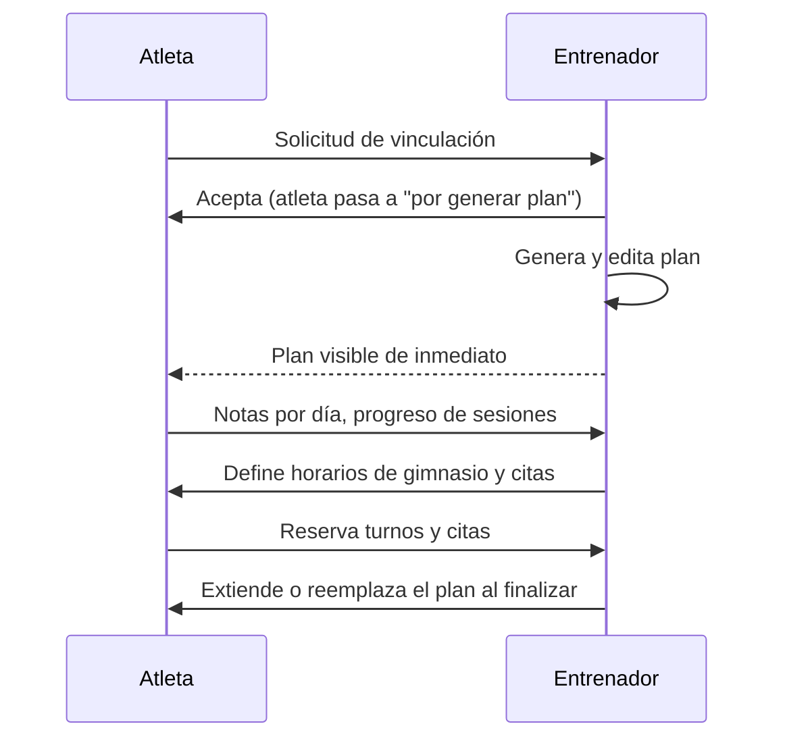

# Rol Entrenador — Documentación Funcional Completa

Describe en detalle todo lo que puede hacer el **Entrenador (TRAINER)**, cómo funciona cada pantalla y las reglas de negocio asociadas. Para el rol atleta ver [ROL_ATLETA.md](./ROL_ATLETA.md) y para el administrador [ROL_ADMINISTRADOR.md](./ROL_ADMINISTRADOR.md).

## Índice

1. [Visión general](#1-visión-general)
2. [Registro, acceso y suscripción](#2-registro-acceso-y-suscripción)
3. [Estructura y navegación](#3-estructura-y-navegación)
4. [Límites del plan y medidores](#4-límites-del-plan-y-medidores)
5. [Pestaña Planes](#5-pestaña-planes)
6. [Generación automática de un plan](#6-generación-automática-de-un-plan)
7. [Editor de planes](#7-editor-de-planes)
8. [Constructor de sesiones de atletismo](#8-constructor-de-sesiones-de-atletismo)
9. [Editor de sesiones de gimnasio](#9-editor-de-sesiones-de-gimnasio)
10. [Extender planes y aviso de fin de plan](#10-extender-planes-y-aviso-de-fin-de-plan)
11. [Solicitudes de atletas](#11-solicitudes-de-atletas)
12. [Mis Atletas](#12-mis-atletas)
13. [Datos básicos y lesiones del atleta](#13-datos-básicos-y-lesiones-del-atleta)
14. [Horarios de gimnasio](#14-horarios-de-gimnasio)
15. [Citas 1 a 1](#15-citas-1-a-1)
16. [Explorar (hub de accesos)](#16-explorar-hub-de-accesos)
17. [Configuración](#17-configuración)
18. [Cómo se conecta con el atleta](#18-cómo-se-conecta-con-el-atleta)
19. [Datos persistidos](#19-datos-persistidos)
20. [Limitaciones actuales](#20-limitaciones-actuales)

---

## 1. Visión general

El entrenador es el **núcleo operativo** de la plataforma. Sus responsabilidades:

- Aceptar atletas y mantener su cartera.
- Generar, editar, extender y dar seguimiento a **planes de entrenamiento** (atletismo y gimnasio).
- Definir **disponibilidad** de gimnasio (cupos) y de citas 1 a 1.
- Mantener su **biblioteca personal** de ejercicios y equipamiento, sus **unidades de medida** y los datos de su **empresa**.
- Registrar **datos básicos y lesiones** de cada atleta (solo el entrenador puede hacerlo).

---

## 2. Registro, acceso y suscripción

### Registro

Pantalla de autenticación con el selector de tipo de cuenta (**Entrenador** / **Atleta**). Para un entrenador:

| Campo                | Regla                                                                         |
| -------------------- | ----------------------------------------------------------------------------- |
| Nombre completo      | Obligatorio; debe ser único en la plataforma (_"Este nombre ya está en uso"_) |
| Email                | Obligatorio, formato válido; único (_"Este email ya está registrado"_)        |
| Contraseña           | Mínimo 6 caracteres (_"La contraseña debe tener al menos 6 caracteres"_)      |
| Confirmar contraseña | Debe coincidir (_"Las contraseñas no coinciden"_)                             |
| Tipo de cuenta       | Entrenador (por defecto en el formulario) o Atleta                            |

Incluye botón para mostrar/ocultar contraseña. La contraseña se almacena con PBKDF2-SHA256 y sal aleatoria (Web Crypto API; requiere HTTPS o localhost).

### Suscripción inicial

- Plan **FREE** con estado **TRIAL** por **14 días**.
- Al iniciar sesión, si el trial venció, el estado pasa a **EXPIRED**.
- El aviso **Modo Demo** (banner) muestra los días restantes mientras el plan es FREE y el estado es TRIAL.
- La pantalla de precios y upgrade existe en el código pero está **deshabilitada**; hoy solo el plan FREE está operativo.

### Planes de suscripción definidos

| Plan  | Atletas    | Planes activos | Notas                                      |
| ----- | ---------- | -------------- | ------------------------------------------ |
| FREE  | 3          | 2              | 14 días de prueba, marca "Modo Demo"       |
| BASIC | 15         | Ilimitados     | Soporte por email, branding personalizable |
| PRO   | 50         | Ilimitados     | Reportes avanzados, soporte prioritario    |
| GYM   | Ilimitados | Ilimitados     | Hasta 5 entrenadores (aún no implementado) |

> El límite `maxTrainers` del plan GYM está definido en `auth.ts`, pero no se aplica en ningún flujo: hoy no existe forma de asociar varios entrenadores a una misma empresa.

---

## 3. Estructura y navegación

### Barra superior (TopBar)

- Nombre de la empresa del entrenador (si la configuró).
- Alternador de tema **claro/oscuro**.
- Botón de salir (cerrar sesión).

### Navegación principal

En móvil se usa la **barra inferior** con cuatro accesos; en escritorio las mismas secciones aparecen como pestañas en el encabezado:

| Barra inferior | Pestaña interna | Contenido                                              |
| -------------- | --------------- | ------------------------------------------------------ |
| Planes         | `planes`        | Atletas por generar plan, planes activos y completados |
| Atletas        | `mis-atletas`   | Cartera de atletas vinculados                          |
| Explorar       | `explorar`      | Hub: solicitudes, citas, horarios de gimnasio          |
| Config         | `configuracion` | Ejercicios, equipamiento, unidades, empresa            |

En escritorio además existen pestañas directas para **Solicitudes de Atletas (N)**, **Horarios de Gimnasio** y **Citas**.

Al editar un plan a pantalla completa, la barra inferior se **oculta** (modo inmersivo) y se vuelve a mostrar al salir.

---

## 4. Límites del plan y medidores

En el encabezado del panel hay dos **medidores** con barra de progreso:

- **Atletas:** `actuales / máximo` (atletas pendientes + con plan activo).
- **Planes Activos:** `actuales / máximo`.

Reglas visuales:

- ≥ 80 % de uso → estado **advertencia**.
- 100 % → estado **alcanzado** (con mensaje en el tooltip).
- Con máximo infinito se muestra **∞** y nunca hay advertencia.

Bloqueos al alcanzar el límite:

- **Aceptar solicitud:** _"Llegaste al límite de atletas de tu suscripción. Actualiza tu plan para aceptar más."_ (botón Aceptar deshabilitado).
- **Generar plan:** _"Llegaste al límite de planes activos de tu suscripción. Actualiza tu plan para generar más."_ (botón deshabilitado).

---

## 5. Pestaña Planes

Tiene tres secciones y, cuando corresponde, un banner de avisos arriba.

### 5.1 Atletas por Generar Plan

Atletas aceptados que todavía **no tienen plan**. Cada tarjeta muestra **Objetivo**, **Nivel**, **Duración** (semanas; 4 por defecto) y la fecha de envío. Botón **Generar Plan**, que crea el plan y abre el editor (ver [sección 6](#6-generación-automática-de-un-plan)).

Estado vacío: _"No hay atletas esperando plan."_

### 5.2 Planes Activos

Tarjetas con insignia **Activo**, **Objetivo**, **Progreso (%)**, fecha de **Finaliza** y fecha de generación. Acciones:

- **Editar Plan:** abre el editor. Si el plan es antiguo y no tiene estructura editable, avisa _"Este plan es antiguo y no se puede editar visualmente."_
- **Extender Plan:** ver [sección 10](#10-extender-planes-y-aviso-de-fin-de-plan).

### 5.3 Planes Completados

Planes cuya fecha de fin ya pasó (o fueron finalizados). Muestran **Completado** y fecha de finalización; el botón **Ver Plan** abre el plan para consulta.

### 5.4 Cierre automático de planes

Al entrar al panel se ejecuta el auto-completado: los planes vencidos pasan a completados tras un **margen de gracia de 2 días** después de su fecha de fin. Ese margen da tiempo a mostrar el aviso de fin de plan.

---

## 6. Generación automática de un plan

`generatePlan` toma los datos del atleta (objetivo, nivel y duración en semanas, 4 por defecto) y produce una estructura de semanas de 7 días.

### Patrón semanal generado

| Día       | Tipo      | Contenido                                                    |
| --------- | --------- | ------------------------------------------------------------ |
| Lunes     | Gimnasio  | Tren superior: 2 ejercicios de empuje, 2 de jalón, 2 de core |
| Martes    | Atletismo | Sesión de calidad                                            |
| Miércoles | Gimnasio  | Tren inferior: 4 ejercicios de pierna y 2 de core            |
| Jueves    | Atletismo | Sesión de calidad                                            |
| Viernes   | Descanso  | —                                                            |
| Sábado    | Atletismo | Carrera larga                                                |
| Domingo   | Descanso  | —                                                            |

### Sesión de gimnasio generada

Título del día, y por cada ejercicio: nombre, **3 series**, repeticiones **10-12**, peso vacío, unidad (lb/kg según preferencia del entrenador) y descanso de **1'**.

### Sesión de atletismo generada

Incluye **tipo de sesión** (por ejemplo Desarrollo, Recuperación), **tipo de entrenamiento** (Series, Fartlek, Carrera continua, etc.), **calentamiento**, **bloque principal** y **enfriamiento** con la notación de ritmos de la app.

El plan resultante siempre se abre en el editor para ajustarlo antes de guardarlo.

---

## 7. Editor de planes

Interfaz completa para modificar cualquier parte del plan.

### Modos de vista

- **Editor:** edición visual.
- **Vista Previa:** el plan convertido a texto plano.
- **División:** ambas a la vez.

### Operaciones sobre semanas

- Expandir/contraer cada semana.
- **Mover** semana hacia arriba/abajo.
- **Duplicar** semana (copia la estructura sin arrastrar el progreso previo).
- **Aplicar una semana a todas** (copia el patrón a las demás).
- **Eliminar** semana (no permite dejar el plan sin semanas).
- La numeración se recalcula automáticamente.

### Operaciones sobre días

- Cambiar el tipo de día: **Descanso**, **Atletismo** o **Gimnasio**.
- **Mover** el contenido de un día hacia arriba/abajo (intercambia la sesión entre días; los nombres Lunes a Domingo permanecen fijos).

### Guardado

- **Autoguardado** con retardo de 1,5 s solo si hubo cambios reales; el botón muestra estado _guardando_ / _guardado_.
- **Guardar Plan:** confirma los cambios y cierra el editor (_"Plan guardado correctamente"_). Los cambios quedan visibles de inmediato para el atleta.
- **Cancelar:** descarta y vuelve al listado.

### Unidades

Usa las preferencias del entrenador (km/mi y lb/kg), configurables en Configuración → Unidades.

---

## 8. Constructor de sesiones de atletismo

Editor visual del bloque de entrenamiento de atletismo.

- **Calentamiento** y **enfriamiento:** duración (minutos y segundos) y ritmo (ejemplo `8'@TRO`).
- **Bloque principal** compuesto por **segmentos** de cuatro tipos:
  1. **Simple:** distancia o tiempo a un ritmo.
  2. **Intervalos:** N repeticiones de distancia/tiempo a un ritmo con descanso.
  3. **Progresivo:** del ritmo inicial al final.
  4. **Fartlek:** alternancia de ritmo rápido/lento.
- Cada segmento admite tipo de medida (**tiempo** o **distancia**), repeticiones, ritmos y descanso (por tiempo o distancia).
- **Símbolos** rápidos para insertar (por ejemplo `[C]` calentamiento, `[A]` afloje, `D:` descanso de serie, `DB:` descanso de bloque, flechas de tendencia, `F.` fuerte, `S.` suave).
- **Visualizador de barras** con la estructura del entrenamiento (calentamiento, segmentos y afloje) para validarla de un vistazo.

---

## 9. Editor de sesiones de gimnasio

- **Título** de la sesión.
- Lista numerada de **ejercicios**, cada uno con:
  - **Nombre:** autocompletado desde la biblioteca personal del entrenador (o el catálogo completo si aún no la configuró; en ese caso se muestra un aviso invitando a configurarla).
  - **Series**, **repeticiones**, **peso** (opcional) y **unidad** (lb/kg).
  - **Descanso:** valor y unidad (segundos o minutos).
  - **Notas** del ejercicio.
  - **Vista previa** con GIF y músculos objetivo cuando hay metadata.
- Agregar, **reordenar** (arriba/abajo) y eliminar ejercicios.
- Insignia de color según grupo (pierna, empuje, tracción, core).

---

## 10. Extender planes y aviso de fin de plan

### Extender Plan

Desde un plan activo (o desde el aviso). Diálogo **"Extender plan"**: elegir **1, 2 o 3 semanas**. El sistema:

- Agrega semanas nuevas repitiendo el patrón de entrenamiento de la última semana, con el progreso reiniciado.
- Suma la duración y mueve la fecha de finalización.
- Muestra _"Plan de {atleta} extendido N semana(s) más"_.

### Aviso "El plan llegó a su fecha de finalización"

Cuando un plan activo alcanza su fecha de fin aparece un banner con tres opciones:

- **Extender Plan.**
- **Agendar Cita:** crea una cita de tipo _Ajuste de Plan_ en el primer horario libre (10:00 a 19:00) desde 3 días después de hoy y lleva al entrenador a **Citas** para reprogramarla con la fecha real.
- **Descartar** (X): oculta el aviso. Se recuerda por plan y fecha de fin; si el plan se extiende, el aviso puede volver a aparecer más adelante.

---

## 11. Solicitudes de atletas

Los atletas encuentran al entrenador (por nombre, email o código) y envían una solicitud. En **Solicitudes de Atletas (N)** cada tarjeta muestra nombre, email, mensaje (si lo hay) y fecha.

- **Aceptar:** el atleta se vincula y aparece en _Atletas por Generar Plan_. Bloqueado si se alcanzó el límite de atletas. Toast _"Solicitud aceptada correctamente"_.
- **Rechazar:** descarta la solicitud. Toast _"Solicitud rechazada"_.
- Mientras se procesa una acción, los botones muestran estado de carga para evitar doble clic.
- Estado vacío con explicación de cuándo aparecerán solicitudes.

Regla: un atleta solo puede tener **una solicitud pendiente** a la vez y debe haber completado su registro con email y contraseña.

---

## 12. Mis Atletas

Lista de atletas vinculados con: nombre, email y teléfono actuales (leídos en vivo del perfil del atleta) y **fecha de vinculación**.

Acciones por atleta:

- **Datos y Lesiones:** abre el formulario de [sección 13](#13-datos-básicos-y-lesiones-del-atleta).
- **Quitar:** diálogo _"¿Seguro que quieres quitar a {nombre} de tu lista? Podrá volver a enviarte una solicitud más adelante."_ Toast _"Atleta removido"_.

Estado vacío con acceso directo a **Ver Solicitudes**.

---

## 13. Datos básicos y lesiones del atleta

Modal **"Datos Básicos y Lesiones"**. **Solo el entrenador** puede crear o editar esta información; el atleta la ve en modo lectura.

### Datos básicos (todos opcionales)

| Campo               | Validación                                             |
| ------------------- | ------------------------------------------------------ |
| Fecha de nacimiento | Fecha válida y no futura                               |
| Peso (kg)           | Entre 1 y 300 (_"Peso inválido (entre 1 y 300 kg)"_)   |
| Altura (cm)         | Entre 1 y 250 (_"Altura inválida (entre 1 y 250 cm)"_) |
| Deporte             | Texto libre                                            |

### Lesiones

Lista editable. Cada lesión tiene:

- **Descripción** (obligatoria: _"La descripción de la lesión es obligatoria"_).
- **Estado:** _Activa_ o _Recuperada_.
- Botón para eliminarla y **Agregar lesión** para sumar otra (se registra con la fecha actual).

Las lesiones con descripción vacía se descartan al guardar. **Guardar** se deshabilita mientras haya errores. Toast _"Datos del atleta actualizados"_.

---

## 14. Horarios de gimnasio

Define las franjas que los atletas pueden reservar, **día por día**.

- Navegación por **día anterior / siguiente** y selector de fecha.
- Cada **bloque**: hora de **inicio**, **fin** y **cupos** (mínimo 1). Se muestra cuántos están reservados.
- **Agregar Bloque:** el nuevo bloque arranca donde termina el anterior y dura una hora (el primero sugiere 08:00-09:00, con 10 cupos).
- **Validación:** el fin debe ser posterior al inicio; si no, el bloque se marca en rojo y no permite guardar ni copiar.
- **Guardar Cambios** (_"Horarios guardados correctamente"_).
- **Copiar a otro día:** replica los bloques en una fecha destino.
- Eliminar bloques individuales.

---

## 15. Citas 1 a 1

Dos pestañas: **Citas** y **Disponibilidad**.

### Citas

- Navegación por día y selector de fecha.
- **Línea de tiempo** con las citas del día ordenadas por hora: hora, duración, tipo, atleta y notas.
- Tipos disponibles para el atleta: **Evaluación Inicial** (60 min), **Seguimiento** (30), **Control de Peso** (15) y **Ajuste de Plan** (45).
- Estados: programada, confirmada, completada y cancelada.
- Acciones: **Confirmar**, **Cancelar** (con motivo) y **Reprogramar** (nueva fecha y hora; _"Cita reprogramada correctamente"_).
- Cada entrenador ve solo sus citas (las de sus atletas aceptados o con su `trainerId`). Agendar o reprogramar se rechaza si el horario se cruza con otra cita del mismo entrenador o atleta (duración por defecto 30 min). La disponibilidad también es por entrenador.

### Disponibilidad

Misma mecánica que los horarios de gimnasio: bloques con inicio/fin/cupos, validación de fin posterior al inicio, guardar y copiar a otra fecha.

---

## 16. Explorar (hub de accesos)

Tarjetas de acceso rápido con contexto:

- **Solicitudes de Atletas** (indica cuántas hay pendientes).
- **Citas 1 a 1** (disponibilidad y agenda).
- **Horarios de Gimnasio** (cupos y franjas).

---

## 17. Configuración

Cuatro sub-pestañas.

### Ejercicios (biblioteca personal)

- Muestra estadísticas: total de ejercicios seleccionados y categorías con contenido.
- Búsqueda por nombre y filtro por categoría.
- **Agregar ejercicios:** modal con pestañas por categoría, selección múltiple, _seleccionar todos_ / _limpiar_, búsqueda, e indicación de los ya seleccionados. Botón _Agregar N ejercicios_.
- **Quitar** ejercicio con confirmación.
- El catálogo disponible es el del sistema, más los agregados por el Admin, menos los que el Admin ocultó.

### Equipamiento (biblioteca personal)

- Estadísticas: equipos seleccionados, disponibles y en mantenimiento.
- Filtros por búsqueda, categoría y estado.
- **Agregar equipamiento** desde el catálogo maestro (selección múltiple) y **quitar** con confirmación.
- Nota: el filtrado automático de ejercicios según el equipamiento aún no está activo; hoy el equipamiento es informativo.

### Unidades

Preferencias que se aplican al crear y editar planes:

- **Distancia:** KM o MI.
- **Peso:** LB o KG.

### Empresa

Datos del negocio del entrenador, visibles para sus atletas vinculados:

- **Nombre de la empresa** (obligatorio), **cédula jurídica** (opcional), **teléfono** (obligatorio) y **dirección** (opcional).
- Modo vista con _"Sin definir"_ para vacíos y modo edición con validaciones.
- Toast _"Datos de la empresa actualizados"_. Solo un entrenador puede editar estos datos.

---

## 18. Cómo se conecta con el atleta

---

## 19. Datos persistidos

| Clave en `localStorage`                                   | Contenido                         |
| --------------------------------------------------------- | --------------------------------- |
| `clients`                                                 | Atletas con sus planes            |
| `athleteRequests`                                         | Solicitudes entrenador-atleta     |
| `appointments` / disponibilidad de citas                  | Citas y bloques                   |
| Disponibilidad y reservas de gimnasio                     | Franjas y reservas                |
| `trainer_exercises_{id}` / `trainer_equipment_{id}`       | Bibliotecas personales            |
| `trainer_plan_distance_unit` / `trainer_plan_weight_unit` | Unidades                          |
| `trainer_dismissed_plan_decisions`                        | Avisos de fin de plan descartados |

---

## 20. Limitaciones actuales

- Sin backend: los datos no se sincronizan entre dispositivos.
- Upgrade de suscripción deshabilitado; solo FREE.
- El equipamiento seleccionado aún no restringe los ejercicios disponibles.
- Un único entrenador por empresa: es una convención actual, no una restricción validada en el código. Cada cuenta `TRAINER` actúa como superusuario de su propia empresa.
- El multi-entrenador del plan GYM no está implementado. Una evolución prevista sería una entidad `Company` y un cargo dentro de la empresa (por ejemplo `OWNER` o `COACH`), manteniendo `TRAINER` como rol de sistema, en lugar de crear un cuarto rol.
